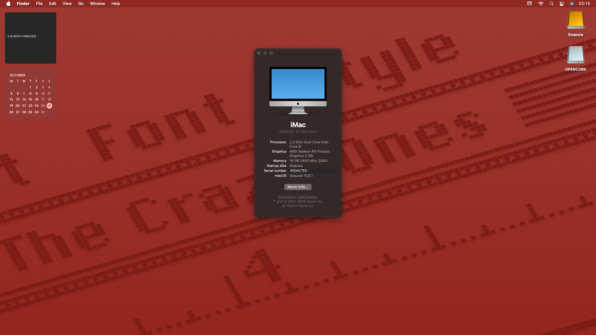

# Sequoia project gallery

## Desktop capture — 2026-10-25

The maintainer supplied this real screenshot and requested its inclusion in the Sequoia project gallery. It shows the desktop and About This Mac at one moment. This is a visual record, not a new release or a stability test.

The physical project computer remains the HP 86F3 with AMD Athlon Silver 3050U. The iMac and Intel labels visible in macOS are reported identity strings; they do not establish different physical hardware or a 5K display.

## Privacy and provenance

- The original screenshot remains private and unchanged.
- The public PNG retains the original 1920 × 1080 dimensions.
- Opaque masks hide the serial-number value and the weather/location widget; embedded metadata was removed.
- Every RGB pixel outside the two masked regions was verified against the original. No generative reconstruction or alteration of system values was used.
- The image was fully decoded and visually reviewed before publication.

This user-supplied screenshot is distinct from the AI-generated README banner. AI assisted with the documentation and review under direct maintainer instruction; it did not generate the captured desktop.

Visible third-party interface elements and trademarks remain attributable to their owners. No endorsement or new blanket license is claimed. See [AI_DISCLOSURE.md](../AI_DISCLOSURE.md), [LEGAL.md](../LEGAL.md) and [SECURITY.md](../SECURITY.md).
